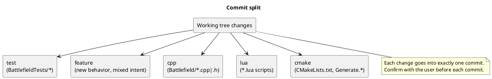
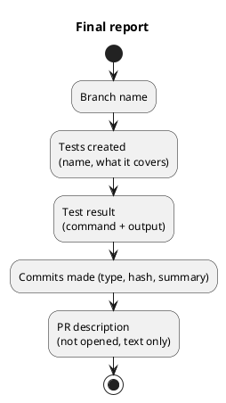

# CLAUDE.md — BattlefieldCpp (DLL / C++ project)

This file defines the work pipeline Claude must follow in this repository.
Workflows are written in PlantUML; render them with any PlantUML viewer.

## Rules

### C++ / DLL rules
- Everything must be tested. Every feature, fix or behavior change needs a test that covers it (tests live in `BattlefieldTests`).
- Never report a task as done without running the tests.
- When reporting back, describe each test created (what it covers, why) and show its actual result (command run + output).

### Rules for all work
- Before starting, create a new branch from the current branch.
- Always split commits by type: `test`, `feature`, `cpp`, `lua`, `cmake` (one commit per type, never mixed).
- Confirm with the user before every commit (show the planned commits and files first).
- Do NOT create a PR. At the end of the task, send the PR description in the final message.
- Prefer PlantUML for workflows, flows, architecture and sequences in docs and reports; use plain text only when a diagram adds nothing.

## Work pipeline

```plantuml
@startuml
title Task pipeline
start
:Create branch from current branch;
:Implement (feature / cpp / cmake / lua);
:Write tests covering the feature;
:Build and run tests;
if (Tests pass?) then (yes)
else (no)
  :Fix code or tests;
  back to :Build and run tests;
endif
:Split changes by type\n(test / feature / cpp / lua / cmake);
:Show planned commits to user;
if (User confirms?) then (yes)
  :Create commits, one per type;
else (no)
  :Adjust plan per user feedback;
  back to :Show planned commits to user;
endif
:Report back:\n- tests created\n- test results\n- PR description;
stop
@enduml
```

## Commit split



## Final report template


