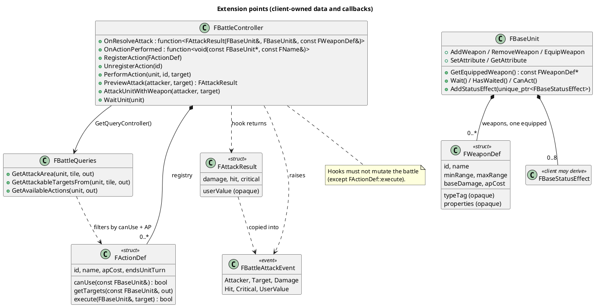

# Architecture

## Layering

plantuml file `architecture.puml` (first diagram: layering; second diagram: the extension points, embedded below and described in [extension-points.md](extension-points.md)).

Dependencies only point downwards: `FGrid` knows nothing about battles, `FBaseUnit` knows nothing about
the controller, and the controller is the only place where the pieces are combined.

## Classes

| Class | File | Responsibility |
|---|---|---|
| `FGrid` | `Core/Grid.h` | Tile storage, bounds checks, tile weights, opaque tile tags (`SetTileTag`/`GetTileTag`/`SetTile`, never read by pathing/blocking/LOS), occupancy, unit positions, BFS path (`GetPath`), weighted search (`GetWeightedPath`, `GetWeightedDistance`, `GetWeightedNeighbours`), Manhattan neighbourhoods, line of sight, visible tiles. Search scratch buffers are generation-stamped so a search never clears arrays. |
| `FGridEntity` | `Core/GridEntity.h` | Anything that can stand on a tile: unit id, team, virtual `CanMove`. Identity-based equality. |
| `FBaseUnit` / `FUnit` | `Core/BaseUnit.h` | Health, AP/move budgets, weapon list (`AddWeapon`/`EquipWeapon`/`GetEquippedWeapon`, `FWeaponDef` in `Core/Weapon.h`), status-effect slots, turn state (`Wait`/`HasWaited`/`CanAct`), attribute bag (`SetAttribute`/`GetAttribute`), tag, display name, damage/heal, client-created status effects (`AddStatusEffect(std::unique_ptr<FBaseStatusEffect>)`), per-unit callbacks (`OnDeath`, `OnReceiveDamage`, `OnStatus*`). `FUnit` is the concrete unit with a convenient constructor. |
| `FBaseStatusEffect` / `FStatusEffect` | `Core/StatusEffects/` | A status identified by a `uint8` type id with a tick counter. The generic `FStatusEffect` drains the unit's AP and movement on every tick (a "stun"). Derive from `FBaseStatusEffect` for custom behaviour. |
| `FTeamSystem` | `Core/TeamSystem.h` | Current team, rotation, per-turn resource refresh (also clears the wait flag), "can this unit act now" (optionally rejecting units that waited, `SetRequireWait`), defeat/winner detection, unit id generation. |
| `FTroupe` | `Core/Troupe.h` | Owns the units of one team (`unique_ptr`), creates them (`CreateActor<T>`) and registers them in the team system. |
| `FBattlefieldData` | `Core/BattlefieldData.h` | The three troupes (Player, Enemy, Neutral). |
| `FWeaponDef` | `Core/Weapon.h` | Data-driven weapon: inclusive range band, damage, AP cost, opaque `typeTag` and `properties`. A unit owns a list and equips one. |
| `FAttackResult` | `Events/AttackResult.h` | `{damage, hit, critical, userValue}` returned by the client's `FBattleController::OnResolveAttack` hook; also what `PreviewAttack` returns. |
| `FActionDef` | `Core/Action.h` | Client-defined action: id, name, `apCost`, `endsUnitTurn` and optional `canUse` / `getTargets` / `execute` callbacks. Registered with `FBattleController::RegisterAction`, listed by `FBattleQueries::GetAvailableActions`, run by `PerformAction`. |
| `FBattleQueries` | `Core/BattleQueries.h` | Read-only questions about the battle (incl. `GetAttackArea` and `GetAttackableTargetsFrom` for weapon range bands). Obtained from `FBattleController::GetQueryController()`. |
| `FBattleController` | `Core/BattleController.h` | Mutating operations + all battle-level events. Owns the troupes and team system, borrows the grid. |
| `FGridMath` | `Math/GridMath.h` | Grid ↔ world coordinate conversion (plain, centred, with offset). |
| `FBattlefieldLog` | `Platform/BattlefieldLog.h` | Optional log sink replacing `UE_LOG`. |

## Ownership and lifetime

* The **grid is owned by the caller**; `FBattleController` stores a raw pointer. The grid must outlive the
  controller, and the controller must not be copied or moved after construction — its queries point at its own
  members. Create it in place (`FBattleController controller(&grid);`). Returning a prvalue from a factory is fine
  because of guaranteed copy elision.
* **Units are owned by their troupe** and live until `FBattlefieldData::Clear()` / `FTroupe::DestroyActor`.
  Dead units stay allocated (so event handlers can still read them) but are removed from their grid tile.
* Pointers returned by `SpawnUnit` stay valid for the controller's lifetime (units are heap allocated).

## Events

All events are `std::function` members that may be left empty.

| Source | Callback | Payload |
|---|---|---|
| Controller | `OnBattleStarted`, `OnBattleEnded`, `OnWinnerDeclared` | start data / winning team |
| Controller | `OnTurnStarted`, `OnTurnEnded` | team |
| Controller | `OnUnitSpawned` | unit, tile |
| Controller | `OnUnitMoved` | `FBattleMoveEvent{Unit, From, To}` |
| Controller | `OnUnitDidAttacked` | `FBattleAttackEvent{Attacker, Target, Damage, Hit, Critical, UserValue}` (the last three come from `FAttackResult`; `Hit=false` is a miss) |
| Controller | `OnUnitDidHealed` | `FBattleHealEvent{Attacker, Target, Value}` (`BattleHealEvent` kept as a deprecated alias for one release) |
| Controller | `OnUnitDamaged` / `OnUnitHealed` | `FBattleDamageEvent` / `FBattleHealedEvent` |
| Controller | `OnUnitDied`, `OnUnitActionPerformed`, `OnUnitWaited` | unit |
| Controller | `OnActionPerformed` | unit, action id (fired by `PerformAction`, after `OnUnitActionPerformed`) |
| Controller | `OnStatusAdded/Removed/Triggered` | unit, status type |
| Unit | `OnDeath`, `OnReceiveDamage`, `OnReceivedHeal`, `OnStatusAdded/Removed/Triggered` | raw unit-level hooks (the controller installs its own on spawn) |

## DLL boundary

* `BATTLEFIELD_API` (in `Platform/CoreTypes.h`) expands to `__declspec(dllexport)` while compiling the library
  (`BATTLEFIELD_EXPORTS`), `__declspec(dllimport)` for clients, and `visibility("default")` elsewhere.
  Define `BATTLEFIELD_STATIC` to compile the sources straight into an application instead.
* The API is a C++ API (classes with STL members), so client and DLL must be built with the same compiler and
  the same (dynamic) C runtime. Warning C4251 is silenced for that reason.
* The tests DLL, by contrast, exposes a flat **C** API (see [testing.md](testing.md)) that any language can call.

## Extension points

The client owns all game design; the DLL only stores data (`FWeaponDef`, attributes, tile tags) and calls back
(`OnResolveAttack`, `FActionDef` callbacks). See [extension-points.md](extension-points.md) for examples and the rule
that hooks must not mutate the battle.

### Callback ownership and lifetime

* Every `std::function` (events, `OnResolveAttack`, `FActionDef` callbacks) is **copied into** the controller, so
  the client may let its own handle go. Captured references and pointers are the client's to keep alive.
* `FActionDef` is copied on `RegisterAction`; `PerformAction` runs a copy, so `execute` may register or unregister
  actions. Pointers from `GetAvailableActions` and `GetEquippedWeapon` are invalidated by registry / weapon-list changes.
* `AddStatusEffect(std::unique_ptr<FBaseStatusEffect>)` moves ownership to the unit.
* `OnResolveAttack` runs while the controller is in the middle of an attack: it must only read (asserted in debug).
