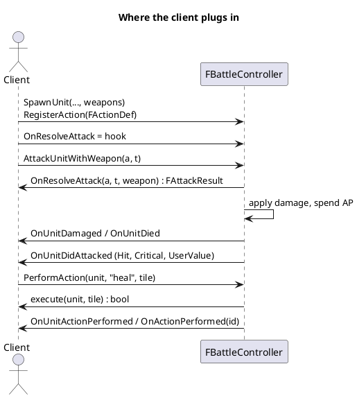

# Extension points

The DLL provides generic mechanics. Everything that is game design (what a sword is, hit and crit formulas, what
"Heal" does) lives in the client, as data and callbacks. This page shows how a client plugs in. All code uses only
public headers.



## Weapons (`Core/Weapon.h`)

A weapon is plain data: an inclusive Manhattan range band, damage, AP cost, an opaque `typeTag` and an opaque
`properties` map (might, hit, weight, durability... the DLL never reads them).

```cpp
FWeaponDef sword;
sword.id = "iron_sword"; sword.minRange = 1; sword.maxRange = 1; sword.baseDamage = 5; sword.apCost = 1;
sword.typeTag = 1;                          // the client's own "kind" number
sword.properties = {{"might", 5}, {"hit", 90}, {"weight", 5}};

FWeaponDef bow = sword;
bow.id = "short_bow"; bow.minRange = 2; bow.maxRange = 2;   // cannot hit adjacent units

FBattleController::FUnitData hero{"Hero", ETeams::Player, stats, turn, legacyWeapon, {1, 1}};
hero.weapons = {sword, bow};               // index 0 is equipped; replaces legacyWeapon

unit->EquipWeapon(1);                      // switch to the bow
controller.GetQueryController()->GetAttackArea(unit, tile, area);              // red overlay
controller.GetQueryController()->GetAttackableTargetsFrom(unit, tile, targets); // AI / "if I moved there"
```

## Attack resolve hook (`OnResolveAttack`)

One callback decides damage, hit and crit. Events and death handling still run through the normal path.

```cpp
controller.OnResolveAttack = [&](FBaseUnit& attacker, FBaseUnit& target, const FWeaponDef& weapon)
{
    FAttackResult r;
    const int32 might = weapon.properties.count("might") ? weapon.properties.at("might") : 0;
    const int32 hit = weapon.properties.count("hit") ? weapon.properties.at("hit") : 100;
    r.damage = might + attacker.GetAttribute("STR") - target.GetAttribute("DEF");
    r.hit = rng.Roll(100) < hit;           // randomness belongs to the client
    r.critical = r.hit && rng.Roll(100) < attacker.GetAttribute("CRIT");
    if (r.critical) r.damage *= 3;
    r.userValue = weapon.typeTag;          // forwarded in FBattleAttackEvent for the UI
    return r;
};

controller.OnUnitDidAttacked = [](const FBattleAttackEvent& e)
{
    if (!e.Hit) ShowText("Miss"); else if (e.Critical) ShowText("Critical!");
};

FAttackResult forecast = controller.PreviewAttack(attacker, target);   // battle forecast box, applies nothing
```

* A miss still spends AP and raises `OnUnitDidAttacked` (damage 0, `Hit == false`), but not `OnUnitDamaged`.
* The hook is never called for an illegal attack (wrong team, out of range, no AP, unarmed).
* Without a hook the built-in distance and aim formula is used.
* `PreviewAttack` calls the same hook, so the hook must be **pure for previews**: roll the RNG outside the hook
  (for example pre-roll per attack) or accept that a forecast and the real attack may differ. The DLL itself never
  consumes random numbers.

## Custom actions (`Core/Action.h`)

```cpp
FActionDef heal;
heal.id = "heal"; heal.name = "Heal"; heal.apCost = 1; heal.endsUnitTurn = true;
heal.canUse = [](const FBaseUnit& u) { return u.GetAttribute("MAG") > 0; };
heal.getTargets = [&](const FBaseUnit& u, std::vector<FGrid::FGridCoordinate>& out)
{
    // tiles of wounded allies in reach: for the UI and the AI, the DLL never calls this itself
};
heal.execute = [&](FBaseUnit& u, FGrid::FGridCoordinate tile)
{
    FBaseUnit* ally = controller.GetQueryController()->GetUnitAt(tile);
    if (!ally || ally->IsEnemy(&u)) return false;       // false = cancelled, nothing is spent
    ally->ReceiveHeal(u.GetAttribute("MAG"));
    return true;
};
controller.RegisterAction(heal);

std::vector<const FActionDef*> available;
controller.GetQueryController()->GetAvailableActions(unit, available);   // menu content
controller.PerformAction(unit, "heal", {3, 4});
```

`PerformAction` order: validate (current team, able to act, registered id, enough AP, `canUse`) → `execute` →
spend `apCost` → `OnUnitActionPerformed` and `OnActionPerformed(unit, id)` → if `endsUnitTurn`, `WaitUnit`
(`OnUnitWaited`). A "Wait" action is just `endsUnitTurn = true` with no `execute`.

Client-defined status effects derive from `FBaseStatusEffect` and are handed over with
`unit->AddStatusEffect(std::make_unique<MyEffect>(unit, typeId))`.

## The rule: hooks must not mutate the battle

| Callback | May mutate the battle? |
|---|---|
| `OnResolveAttack` (and `PreviewAttack`) | **No.** Read-only queries (`GetQueryController()`, unit getters) only. Asserted in debug builds: `SpawnUnit`, `MoveUnit`, `MoveUnitRaw`, `AttackUnitWithWeapon`, `AttackUnitRaw`, `HealUnitRaw`, `WaitUnit`, `PerformAction` and `EndTurn` trip an `assert` while the hook runs. |
| `FActionDef::canUse`, `getTargets` | **No.** They are queries; the DLL may call `canUse` while building a menu. |
| `FActionDef::execute` | **Yes.** It is the action itself and may call controller methods. It may also register or unregister actions. |
| Event callbacks (`OnUnit*`, `OnTurn*`...) | Allowed but discouraged: they run in the middle of the operation that raised them. Prefer queueing the reaction and applying it afterwards. |

## Lifetime

* Callbacks are copied into the controller (`std::function`); they must outlive their captures. If a callback
  captures the controller or a unit by reference, do not let the controller outlive them.
* `const FWeaponDef*` from `GetEquippedWeapon()` and `const FActionDef*` from `GetAvailableActions` are only valid
  until the weapon list or the action registry changes.
* `AddStatusEffect(std::unique_ptr<...>)` transfers ownership to the unit; a rejected effect is destroyed.
