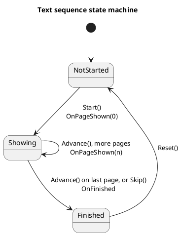
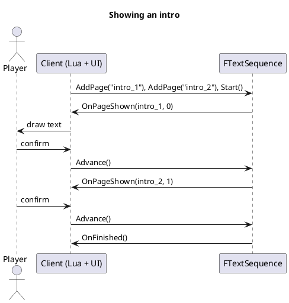

# 09 Text mode

Status: **design, not implemented**. All tasks below are open.

Text mode shows a story text to the player: an intro, a chapter story, an ending. It is a sequence of **pages**; the player advances page by page until the sequence ends. Used by the `Text` node of the [campaign](11-campaign.md), but it works alone.

The DLL runs the sequence (which page is current, skip, finish). It does not store or render text: each page only carries a `textId` that the client resolves (Lua table, localisation file...). This keeps the rule from the [features README](README.md): no game design in C++.

## Concepts

| Concept | Owner | Meaning |
|---------|-------|---------|
| `FTextPage` | DLL (data holder) | `textId`, optional `params` (opaque, client-defined: background, music, pace...). |
| `FTextSequence` | DLL | Ordered pages, current page, state, callbacks. |
| Text content, layout, typewriter effect, input | client | Resolves `textId`, draws it, calls `Advance` on confirm and `Skip` on cancel. |

## API sketch (`Public/Core/TextSequence.h`)

```cpp
enum class ETextSequenceState : uint8 { NotStarted, Showing, Finished };

struct BATTLEFIELD_API FTextPage
{
    FName textId;                          // client data id
    std::map<FName, int32> params;         // opaque, client-defined
};

class BATTLEFIELD_API FTextSequence
{
public:
    std::function<void(const FTextPage&, int32 index)> OnPageShown;
    std::function<void()> OnFinished;      // after the last page, or after Skip

    bool AddPage(const FTextPage& page);   // false: empty textId, or already started
    bool Start();                          // shows page 0; false if empty or already started
    bool Advance();                        // next page, or Finished after the last; false unless Showing
    bool Skip();                           // jumps to Finished; false unless Showing
    void Reset();

    const FTextPage* GetCurrentPage() const;
    ETextSequenceState GetState() const;
    int32 GetPageIndex() const;            // -1 when none
    int32 GetPageCount() const;
};
```

## State machine



## Runtime sequence



Rules:
- Callbacks fire after the state is updated, so a callback may read `GetCurrentPage()`. Calling `Advance` or `Skip` inside a callback is queued and run after the callback returns.
- Pages are copied into the sequence. The `FTextPage&` given to a callback is valid only during that call.
- The sequence never blocks and never waits on a timer. Pace (typewriter, auto-advance) is the client's job.

## Out of scope (stays on the game side)

The text itself, fonts, typewriter effect, auto-advance timers, backgrounds, music, localisation.

## Tasks
- [ ] `Public/Core/TextSequence.h` and `Private/Core/TextSequence.cpp`, added to the `Battlefield` target.
- [ ] `AddPage` validation, `Start`, `Advance`, `Skip`, `Reset`, getters.
- [ ] Callbacks after the state update; queueing of calls made from callbacks.
- [ ] Tests in `BattlefieldTests/Private/Tests/TextSequenceTests.cpp` (add to `BattlefieldTests/CMakeLists.txt`):
  - three pages advance in order and `OnPageShown` gets the right page and index;
  - `Advance` on the last page finishes and fires `OnFinished` once;
  - `Skip` from the middle finishes;
  - empty `textId`, `Start` on an empty or started sequence, `AddPage` after start are rejected;
  - `Advance` and `Skip` before `Start` and after `Finished` return `false` and change nothing;
  - `Advance` called inside `OnPageShown` is queued;
  - `Reset` allows a second run.
- [ ] Docs: `architecture.md` (class table, events), a text section in `extension-points.md`, `testing.md` (suite and test count), `README.md` test count.
- [ ] Game side (separate task in `BattlefieldGame/docs/features`): text screen, `textId` lookup in Lua.

## Done when
A client can load pages as data, drive them with `Advance` and `Skip`, and the DLL never sees the text.

## Files
New `Public/Core/TextSequence.h`, `Private/Core/TextSequence.cpp`, `BattlefieldTests/Private/Tests/TextSequenceTests.cpp`; `Battlefield/CMakeLists.txt`, `BattlefieldTests/CMakeLists.txt`, `docs/architecture.md`, `docs/extension-points.md`, `docs/testing.md`, `docs/README.md`.
