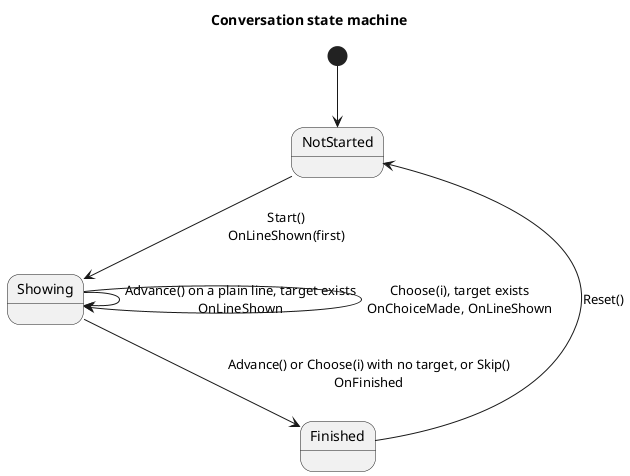
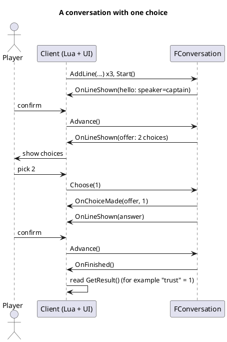

# 10 Conversation mode

Status: **design, not implemented**. All tasks below are open.

Conversation mode runs a dialogue between characters: lines said by a speaker, optionally with choices for the player. Used by the `Conversation` node of the [campaign](11-campaign.md), but it works alone. It differs from [text mode](09-text-mode.md) in having a speaker per line and branching.

The DLL runs the dialogue graph (current line, choices, jumps, finish). It does not store text or portraits: each line carries a `speakerId` and a `textId` the client resolves. This keeps the rule from the [features README](README.md): no game design in C++.

## Concepts

| Concept | Owner | Meaning |
|---------|-------|---------|
| `FConversationLine` | DLL (data holder) | `id`, `speakerId`, `textId`, optional `choices`, optional `next` line id, optional `params`. |
| `FConversationChoice` | DLL (data holder) | `textId`, `next` line id (empty = end), optional `setAttribute` key and value. |
| `FConversation` | DLL | Line list, current line, state, chosen-choice record, callbacks. |
| Text, portraits, voice, layout, input | client | Resolves ids, draws the line, calls `Advance` or `Choose`. |

A line with no `choices` is advanced with `Advance()`: it goes to `next`, or to the following line in list order when `next` is empty, or ends after the last line. A line with `choices` waits for `Choose(index)`.

## API sketch (`Public/Core/Conversation.h`)

```cpp
enum class EConversationState : uint8 { NotStarted, Showing, Finished };

struct BATTLEFIELD_API FConversationChoice
{
    FName textId;
    FName next;                            // line id; empty = end the conversation
    FName attribute;                       // optional: recorded in the result when chosen
    int32 value = 0;
};

struct BATTLEFIELD_API FConversationLine
{
    FName id;                              // unique in the conversation
    FName speakerId;                       // client data id (character)
    FName textId;                          // client data id (what is said)
    FName next;                            // optional, only for lines without choices
    std::vector<FConversationChoice> choices;
    std::map<FName, int32> params;         // opaque, client-defined (mood, portrait...)
};

class BATTLEFIELD_API FConversation
{
public:
    std::function<void(const FConversationLine&)> OnLineShown;
    std::function<void(const FConversationLine&, int32 choiceIndex)> OnChoiceMade;
    std::function<void()> OnFinished;      // after the last line, an ending choice, or Skip

    bool AddLine(const FConversationLine& line);  // false: empty or duplicate id, or already started
    bool Start();                                 // validates `next` targets, shows the first line
    bool Advance();                               // only for a line without choices
    bool Choose(int32 index);                     // only for a line with choices
    bool Skip();                                  // finishes now; unchosen choices are not recorded
    void Reset();

    const FConversationLine* GetCurrentLine() const;
    EConversationState GetState() const;
    // Attributes recorded by choices (attribute -> value), for the client or the campaign to read.
    const std::map<FName, int32>& GetResult() const;
};
```

## State machine



## Runtime sequence



Rules:
- `Start()` returns `false` when a `next` or choice `next` names an unknown line, so a bad graph is caught before the player sees it. Loops are allowed (a "ask again" line); the client decides when to stop offering them.
- `Advance()` on a line with choices, and `Choose()` on a line without, return `false` and change nothing. A `Choose` index out of range does the same.
- Choices write into the result (`attribute` = `value`) when picked. The DLL does not interpret them; the client or the [campaign](11-campaign.md) copies what it needs into its own attribute bag.
- Callbacks fire after the state update. `Advance`, `Choose` and `Skip` called inside a callback are queued and run after it returns.
- Lines are copied in. References given to callbacks are valid only during the call.

## Out of scope (stays on the game side)

Dialogue text, portraits, voice, text effects, conditions that hide choices (the client filters what it shows, but indexes passed to `Choose` refer to the full list), localisation.

## Tasks
- [ ] `Public/Core/Conversation.h` and `Private/Core/Conversation.cpp`, added to the `Battlefield` target.
- [ ] `AddLine` validation, `Start` with graph validation, `Advance`, `Choose`, `Skip`, `Reset`, `GetResult`.
- [ ] Callbacks after the state update; queueing of calls made from callbacks.
- [ ] Tests in `BattlefieldTests/Private/Tests/ConversationTests.cpp` (add to `BattlefieldTests/CMakeLists.txt`):
  - linear conversation advances in list order and finishes after the last line;
  - explicit `next` jump skips a line;
  - `Choose` follows the chosen branch, fires `OnChoiceMade`, records the attribute in `GetResult`;
  - a choice with an empty `next` ends the conversation;
  - `Advance` on a choice line, `Choose` on a plain line and `Choose` out of range are rejected and change nothing;
  - empty and duplicate ids, unknown `next` target, `Start` on empty or started conversation;
  - `Skip` finishes and records no pending choice;
  - a looping line works and can be left through a choice;
  - calls inside callbacks are queued;
  - `Reset` clears state and result.
- [ ] Docs: `architecture.md` (class table, events), a conversation section in `extension-points.md`, `testing.md` (suite and test count), `README.md` test count.
- [ ] Game side (separate task in `BattlefieldGame/docs/features`): conversation screen, speaker and text lookup in Lua.

## Done when
A client can describe a dialogue with speakers and choices as data, drive it with `Advance` and `Choose`, read the recorded result, and the DLL never sees the text.

## Files
New `Public/Core/Conversation.h`, `Private/Core/Conversation.cpp`, `BattlefieldTests/Private/Tests/ConversationTests.cpp`; `Battlefield/CMakeLists.txt`, `BattlefieldTests/CMakeLists.txt`, `docs/architecture.md`, `docs/extension-points.md`, `docs/testing.md`, `docs/README.md`.
