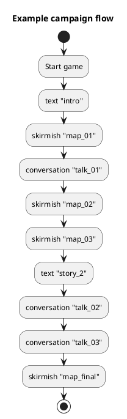
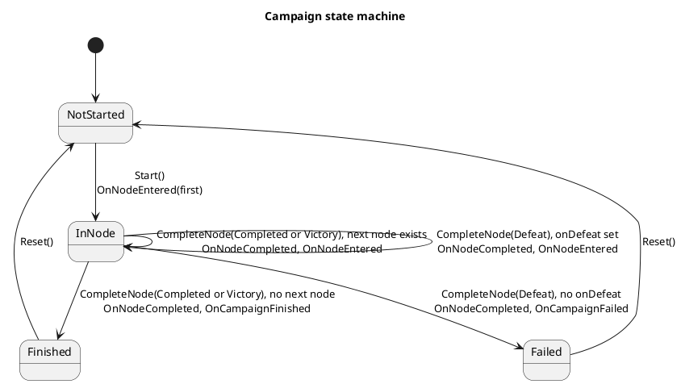
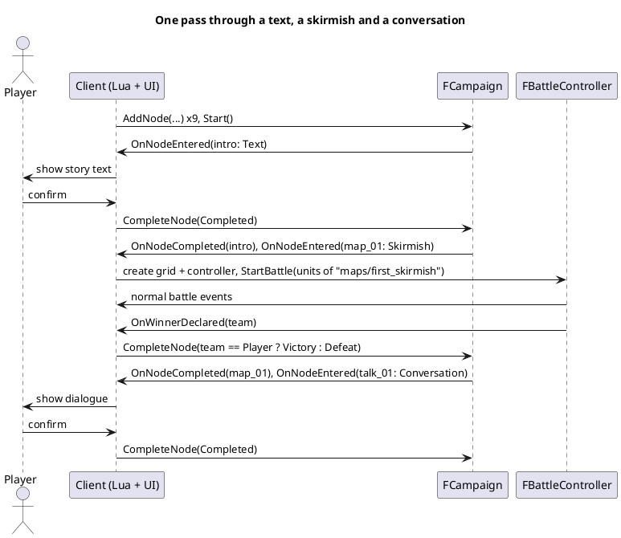

# 11 Campaign: a sequence of game events

Status: **design, not implemented**. All tasks below are open. Depends on [09 Text mode](09-text-mode.md) and [10 Conversation mode](10-conversation-mode.md), which run the content of the `Text` and `Conversation` nodes.

A campaign is an ordered list of **nodes** (an intro text, a skirmish, a conversation...). The DLL walks the list, tells the client which node is active, and moves on when the client reports that the node finished. The DLL does not know what a node *contains*: story text, dialogue lines, maps and units are client data (Lua on the game side), referenced only by id. This keeps the rule from the [features README](README.md): no game design in C++.

## Example game flow



| # | Node id | Kind | Resource (client data id) |
|---|---------|------|---------------------------|
| 1 | `intro` | `Text` | `story/intro` |
| 2 | `map_01` | `Skirmish` | `maps/first_skirmish` |
| 3 | `talk_01` | `Conversation` | `talks/01` |
| 4 | `map_02` | `Skirmish` | `maps/second` |
| 5 | `map_03` | `Skirmish` | `maps/third` |
| 6 | `story_2` | `Text` | `story/chapter_2` |
| 7 | `talk_02` | `Conversation` | `talks/02` |
| 8 | `talk_03` | `Conversation` | `talks/03` |
| 9 | `map_final` | `Skirmish` | `maps/final` |

Several nodes of the same kind in a row (4 and 5, 7 and 8) need no special case: each is its own node.

## Concepts

| Concept | Owner | Meaning |
|---------|-------|---------|
| `FCampaignNode` | DLL (data holder) | `id`, `kind`, `resource`, optional `params`, optional `onVictory` / `onDefeat` next node ids. |
| `ECampaignNodeKind` | DLL | `Text`, `Conversation`, `Skirmish`, `Custom` (the client may add its own kinds through `Custom` + `params`). The DLL only stores it, except that it knows a `Skirmish` ends with a win or a loss. |
| `ECampaignOutcome` | DLL | `Completed` (Text, Conversation, Custom), `Victory`, `Defeat` (Skirmish). |
| `FCampaign` | DLL | The sequencer: node list, current node, state, callbacks. Owns no grid and no battle. |
| Node content | client | Story text, dialogue, map layout and units, looked up by `resource`. A `Text` node is run with [`FTextSequence`](09-text-mode.md) and a `Conversation` node with [`FConversation`](10-conversation-mode.md) (the client creates them when the node is entered and calls `CompleteNode(Completed)` from their `OnFinished`; the conversation result can be copied into the campaign attributes). |
| Skirmish battle | `FBattleController` | The existing controller. The client builds one per skirmish node and forwards `OnWinnerDeclared` to `FCampaign::CompleteNode`. |
| Campaign state | DLL + client | Current node id, completed ids and an attribute bag (`std::map<FName, int32>`) for the client's own flags (route, gold, survivors...). |

## API sketch (`Public/Core/Campaign.h`)

```cpp
enum class ECampaignNodeKind : uint8 { Text, Conversation, Skirmish, Custom };
enum class ECampaignOutcome  : uint8 { Completed, Victory, Defeat };
enum class ECampaignState    : uint8 { NotStarted, InNode, Finished, Failed };

struct BATTLEFIELD_API FCampaignNode
{
    FName id;                              // unique in the campaign
    ECampaignNodeKind kind = ECampaignNodeKind::Text;
    FName resource;                        // client data id (text, talk, map...)
    std::map<FName, int32> params;         // opaque, client-defined
    FName onVictory;                       // optional: next node on Completed/Victory (empty = next in list)
    FName onDefeat;                        // optional: next node on Defeat (empty = campaign Failed)
};

class BATTLEFIELD_API FCampaign
{
public:
    std::function<void(const FCampaignNode&)> OnNodeEntered;
    std::function<void(const FCampaignNode&, ECampaignOutcome)> OnNodeCompleted;
    std::function<void()> OnCampaignFinished;                    // last node completed
    std::function<void(const FCampaignNode&)> OnCampaignFailed;  // Defeat with no onDefeat route

    bool AddNode(const FCampaignNode& node);       // false: empty or duplicate id, or already started
    bool Start();                                  // validates routes, enters the first node
    bool CompleteNode(ECampaignOutcome outcome);   // finishes the current node, enters the next
    bool GotoNode(const FName& id);                // explicit jump (client-driven branching)
    void Reset();

    const FCampaignNode* GetCurrentNode() const;
    ECampaignState GetState() const;
    int32 GetNodeIndex() const;                    // position in the list, -1 when none
    bool IsNodeCompleted(const FName& id) const;

    void SetAttribute(const FName& key, int32 value);
    int32 GetAttribute(const FName& key, int32 fallback = 0) const;

    // Save and load (see "Persistence"): plain data, no pointers.
    struct FSnapshot
    {
        ECampaignState state;
        FName currentNode;
        std::vector<FName> completed;
        std::map<FName, int32> attributes;
    };
    FSnapshot Save() const;
    bool Restore(const FSnapshot& snapshot);       // false if an id is unknown
};
```

`FCampaign` is independent from `FBattleController`: a campaign works without any battle, and a battle works without a campaign (the existing sample keeps working).

## State machine



Next-node rule, in order:
1. `Defeat` with `onDefeat` set: go to `onDefeat`. Without it: `Failed`.
2. `Completed` or `Victory` with `onVictory` set: go to `onVictory`.
3. Otherwise the next node in list order; `Finished` after the last one.
4. A `Text` or `Conversation` node only accepts `Completed`, and a `Skirmish` only `Victory` or `Defeat`; any other combination returns `false` and changes nothing. `Custom` accepts any outcome.

## Runtime sequence (client and DLL)



Rules:
- The client forwards the battle result; the DLL never wires `FCampaign` to `FBattleController` by itself. Both classes stay testable alone, and the win condition (rout, or an objective in Lua) stays a game choice.
- Callbacks fire after the state is updated, so a callback may call `GetCurrentNode()`. A callback may call `CompleteNode` (for example a node with nothing to show); such calls are queued and run after the callback returns, so there is no unbounded recursion.
- Nodes are copied into the campaign. The `FCampaignNode&` passed to a callback is valid only during that call.

## Persistence

`Save()` returns plain data (`FSnapshot`); the DLL does not write files. The client serialises it (Lua table, JSON...) and calls `Restore()` later. Restoring puts the campaign in `InNode` on the saved node and fires `OnNodeEntered` for it, so the client re-opens the right screen. Mid-skirmish saves are out of scope: a saved skirmish node restarts its map.

## Out of scope (stays on the game side)

Story text and dialogue formats, speaker portraits, map and unit data, the text and conversation UI, carry-over of surviving units between maps (the client keeps what it needs in the attribute bag or its own save), score, rewards and difficulty.

## Tasks
- [ ] `Public/Core/Campaign.h` and `Private/Core/Campaign.cpp`: the types above, added to the `Battlefield` target.
- [ ] Node list validation: unique non-empty ids; `onVictory` / `onDefeat` must name existing ids (checked in `Start()`, which returns `false` otherwise).
- [ ] Sequencing: `Start`, `CompleteNode` with the next-node rule, `GotoNode`, `Reset`, state and completed-id tracking.
- [ ] Outcome validation per node kind (rule 4 above).
- [ ] Callbacks fired after the state update; queueing of `CompleteNode` calls made from callbacks.
- [ ] Attribute bag and `Save` / `Restore`.
- [ ] Tests in `BattlefieldTests/Private/Tests/CampaignTests.cpp` (add the file to `BattlefieldTests/CMakeLists.txt`):
  - the full 9-node flow above ends in `Finished`, with `OnNodeEntered` called in order;
  - `Defeat` with and without `onDefeat`;
  - an `onVictory` branch that skips a node;
  - an invalid outcome for a node kind is rejected and changes nothing;
  - duplicate and empty ids, unknown route target, `Start` on an empty or already started campaign;
  - `CompleteNode` before `Start` and after `Finished`;
  - `GotoNode` with an unknown id;
  - callback re-entrancy (`CompleteNode` inside `OnNodeEntered`);
  - `Save` / `Restore` round trip, `Restore` with an unknown id;
  - `Reset` after `Finished`;
  - integration: a real `FBattleController` skirmish whose `OnWinnerDeclared` completes the node.
- [ ] Docs: `FCampaign` in `architecture.md` (class table, events), a campaign section in `extension-points.md`, the new suite and the new test count in `testing.md`, the test count in `README.md`.
- [ ] Game side (separate task in `BattlefieldGame/docs/features`): a Lua campaign file listing the nodes, UI states for text and conversation, forwarding `OnWinnerDeclared`.

## Done when
A client can describe the nine-node flow above as data, drive it with `CompleteNode`, branch on defeat, save and restore it, and the DLL never inspects the text, dialogue or map behind a node.

## Files
New `Public/Core/Campaign.h`, `Private/Core/Campaign.cpp`, `BattlefieldTests/Private/Tests/CampaignTests.cpp`; `Battlefield/CMakeLists.txt`, `BattlefieldTests/CMakeLists.txt`, `docs/architecture.md`, `docs/extension-points.md`, `docs/testing.md`, `docs/README.md`.
